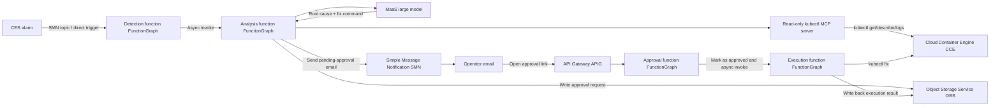

# deterministic-operations-cce-auto-remediation

[](LICENSE)
[](https://support.huaweicloud.com/)
[](#)
> A best practice for automatic detection of CCE cluster faults and "auto-remediation after human approval" based on a large model and a read-only MCP server: a Cloud Eye Service (CES) alarm triggers detection, MaaS drives read-only root-cause investigation, and the fix command is executed by kubectl after human approval.

---

## 1. Overview

This repository `deterministic-operations-cce-auto-remediation` is a ready-to-deploy cloud-native operations best practice. The title and license badges are at the top of this file.

---

## 2. Table of Contents

- [1. Overview](#1-overview)
- [2. Table of Contents](#2-table-of-contents)
- [3. Architecture Diagram](#3-architecture-diagram)
- [4. Highlights](#4-highlights)
- [5. Cloud Services Used](#5-cloud-services-used)
- [6. Prerequisites](#6-prerequisites)
- [7. Quick Start](#7-quick-start)
- [8. Step-by-Step Deployment](#8-step-by-step-deployment)
- [9. Usage / Verification](#9-usage--verification)
- [10. Cleanup](#10-cleanup)
- [11. Detailed Explanation](#11-detailed-explanation)
- [12. Dependencies](#12-dependencies)
- [13. FAQ / Troubleshooting](#13-faq--troubleshooting)
- [14. Contributing](#14-contributing)
- [15. License](#15-license)
- [16. Contact / Maintainers](#16-contact--maintainers)

---

## 3. Architecture Diagram

> An alarm is triggered through CES, the detection function starts the analysis chain, and the fix command is safely applied by the execution function after human approval.



**Key component notes**

- Cloud Eye Service (CES): source of cluster metric alarms
- Cloud Container Engine (CCE): target cluster to be monitored and remediated
- FunctionGraph: four functions (detection / analysis / approval / execution)
- MaaS: large model driving root-cause analysis (default deepseek-v4-flash)
- Object Storage Service (OBS): persistent storage for approval requests
- Simple Message Notification (SMN): pending-approval email push
- API Gateway (APIG): human approval endpoint
- Software Repository for Container (SWR): custom function images
- Read-only kubectl MCP server: started as a subprocess inside the analysis function, exposing read-only verbs only

---

## 4. Highlights

- **Human in the loop**: the AI generates fix suggestions but never executes them automatically; all write operations require human approval, keeping the process safe and controllable
- **Read-only root-cause investigation**: the MCP server enforces a read-only verb allowlist, so the large model cannot perform write operations
- **Safe command execution**: the execution function has a built-in kubectl allowlist and dangerous shell-character filtering; YAML is written to a temporary file instead of a pipe
- **Infrastructure as code**: all resources are declared with Terraform, repeatable and auditable
- **Elastic function architecture**: the four functions (detection / analysis / approval / execution) are decoupled and run on demand

---

## 5. Cloud Services Used

| Service | Purpose | Notes |
|---|---|---|
| Cloud Container Engine (CCE) | Target cluster (object of detection and remediation) | Cluster + node pool |
| Cloud Eye Service (CES) | Cluster metric alarm source | Triggers the detection chain |
| FunctionGraph | Detection / analysis / approval / execution functions | Custom image runtime |
| MaaS | Root-cause analysis large model | Default deepseek-v4-flash |
| Object Storage Service (OBS) | Persistent storage for approval requests | Ecosystem-compatible, scales on demand |
| Simple Message Notification (SMN) | Pending-approval email push | Email subscription |
| API Gateway (APIG) | Human approval endpoint | Backend points to the approval function |
| Software Repository for Container (SWR) | Custom function images | Organization / repository two levels |
| Identity and Access Management (IAM) | Function agency | Least privilege |
| Log Tank Service (LTS) | Function and resource logs | Log group / log stream |
| Key Management Service (KMS) | Credential encryption | Optional |
| Virtual Private Cloud (VPC) / Subnet | Network plane | Network where functions and the cluster reside |

> **Tip**: all services can be created with one click using the Terraform in this repository. To release them, see [Section 10 "Cleanup"](#10-cleanup).

---

## 6. Prerequisites

| Item | Requirement | Notes |
|---|---|---|
| **Account** | Cloud account opened and real-name verification completed | Personal or enterprise account |
| **Permissions** | IAM permissions to create FunctionGraph / CCE / APIG / SMN / OBS resources | Least privilege recommended |
| **Region** | `cn-north-4` recommended | Service availability may differ across regions |
| **Terraform** | `>= 1.5.0` | IaC deployment tool |
| **huaweicloud Provider** | `>= 1.97.0` | Terraform provider for this cloud |
| **Docker** | `>= 20.10` | Build custom function images |
| **kubectl** | `>= 1.28` | Cluster remediation (invoked by the execution function) |
| **Access credentials** | Obtain the Access Key and Secret Access Key on the "My Credentials" page and configure them in environment variables `HW_ACCESS_KEY` / `HW_SECRET_KEY` | Do not write credentials into code or configuration files |

---

## 7. Quick Start

### One-click deployment (recommended)

```bash
# 1. Enter the deployment directory
cd deterministic-operations-cce-auto-remediation/infra

# 2. Prepare access credentials
export HW_ACCESS_KEY="<your-access-key>"
export HW_SECRET_KEY="<your-secret-key>"

# 3. Fill in region, agency name, SWR organization, MaaS endpoint, etc. in terraform.tfvars

# 4. Initialize and preview
terraform init
terraform plan

# 5. Apply the deployment
terraform apply -auto-approve
```

> **Deployment note**: FunctionGraph uses custom images. Build and push the four `docker/*` images to SWR first, then run `terraform apply` (see [Section 8](#8-step-by-step-deployment)).

---

## 8. Step-by-Step Deployment

### Step 1: Build and push function images to SWR

Each of the four functions (detection / analysis / approval / execution) maps to `docker/<name>/Dockerfile`. Taking detection as an example:

```bash
cd deterministic-operations-cce-auto-remediation
# Log in to SWR (address from terraform output or the console)
docker build -f docker/detection/Dockerfile -t swr.<region>.myhuaweicloud.com/<swr_org>/mcp-cce-detection:latest .
docker push swr.<region>.myhuaweicloud.com/<swr_org>/mcp-cce-detection:latest
# Build the analysis / approval / execution images the same way
```

**Expected output**: all four images are pushed successfully, and the corresponding images and versions are visible in the SWR console.

### Step 2: Initialize Terraform

```bash
cd deterministic-operations-cce-auto-remediation/infra
terraform init
```

**Expected output**: `Terraform has been successfully initialized!`

### Step 3: Fill in variables and preview

Edit `terraform.tfvars` and fill in at least: `region`, `agency_name`, `swr_org`, `swr_image_detection/analysis/approval/execution`, `maas_*`, `apig_enabled`, etc. Then:

```bash
terraform plan
```

**Expected output**: `Plan: N to add, 0 to change, 0 to destroy.`

### Step 4: Apply the deployment

```bash
terraform apply -auto-approve
```

**Expected output**: `Apply complete! Resources: N added, 0 changed, 0 destroyed.`

### Step 5: Record key outputs

```bash
terraform output
```

**Expected output**: lists the four function URNs, the SMN topic URN, the APIG approval URL, the OBS bucket name, etc. Save them and feed them back into the function environment variables (some URNs require another `apply` to wire up the async invocation chain).

---

## 9. Usage / Verification

### Verification 1: Local function load smoke test

```bash
cd deterministic-operations-cce-auto-remediation
HW_REGION=cn-north-4 python -c "
import sys; sys.path.insert(0, 'src')
from functions import detection_function
print('detection_function.handler loaded:', callable(detection_function.handler))
"
```

**Expected output**: prints `detection_function.handler loaded: True`, confirming that the function entry point and shared modules import correctly.

### Verification 2: End-to-end alarm self-healing (requires a deployed environment)

1. In the CES console, create a test alarm for the target CCE cluster (e.g., pod restart count) with the action pointing to the SMN topic or the detection function.
2. After triggering the alarm, check whether SMN received the pending-approval email containing the APIG approval link.
3. Open the approval link, submit an `approve` decision, and observe the execution function logs (LTS) trying kubectl commands in the order immediate → preventive → alternative.
4. In the OBS approval-request store, confirm the status transitions `pending` → `approved` → `completed` / `failed`.

**Expected result**: the alarm is detected, the root-cause email is sent, the fix command is safely executed after human approval, and the status is written back correctly.

After deployment, follow these steps to verify that the business functionality works before considering the delivery complete.

---

## 10. Cleanup

```bash
# Enter the deployment directory
cd deterministic-operations-cce-auto-remediation/infra

# Release all resources with one command
terraform destroy -auto-approve
```

**Expected output**: `Destroy complete! Resources: N destroyed.`

> **Avoid residue**:
> - `terraform destroy` only releases resources tracked in the Terraform state;
> - resources manually created in the console (e.g., test alarm rules) must be released manually;
> - SWR images can be deleted manually if they are not going to be reused.

---

## 11. Detailed Explanation

### Solution overview

This practice provides a container-cluster self-healing solution driven by "a large model + a read-only MCP". When Cloud Eye Service (CES) raises a cluster alarm, the system automatically detects the event, invokes the large model together with a read-only kubectl MCP server to investigate the root cause, generates a fix command, pushes a pending-approval email through Simple Message Notification (SMN), and after an operator confirms at the API Gateway (APIG) approval endpoint, the execution function safely runs the kubectl fix command. The whole flow keeps a human in the loop: the AI only generates suggestions and never automatically executes write operations.

**Core capabilities**

- Alarm-driven: CES alarms automatically trigger the detection chain, with no manual inspection required
- Read-only root-cause investigation: the large model collects cluster state through a self-hosted read-only kubectl MCP server, allowing only list/get/describe
- Human-in-the-loop approval: fix commands must be confirmed by an operator through the APIG approval endpoint, preventing accidental execution
- Safe execution: the execution function has a built-in command allowlist and dangerous-character filtering, permitting only kubectl read-friendly fix actions
- Infrastructure as code: all resources are declared with Terraform, and functions are deployed to FunctionGraph as custom images

### Workflow

CES alarm → the detection function parses the alarm and asynchronously invokes the analysis function → the analysis function starts the read-only kubectl MCP server and calls the MaaS large model for root-cause investigation → it produces four analysis sections `ISSUE EXPLANATION / IMMEDIATE ACTION / PREVENTIVE ACTION / ALTERNATIVE ACTION` (each containing a `[KUBECTL]` command) → it writes the approval request to OBS and sends a pending-approval email via SMN → the operator confirms at the APIG approval endpoint → the approval function marks it as approved and asynchronously invokes the execution function → the execution function configures the CCE kubeconfig, runs the kubectl commands in order, and writes back the result.

### Security model

- **Read-only MCP**: the MCP server exposes only read-only verbs such as `get / describe / logs / top`, so the large model cannot perform write operations during investigation.
- **Command allowlist**: the execution function permits only `kubectl` and rejects dangerous characters such as `&& || ; | \` $( > <`; YAML manifests are written to a temporary file instead of a pipe.
- **Human in the loop**: any fix command is executed only after a human `approve` decision at the APIG approval endpoint.
- **Least-privilege agency**: the four FunctionGraph functions bind IAM agencies with the necessary permissions; access credentials are not written in plaintext to environment variables.

### Configuration items (key environment variables)

| Variable | Description |
|---|---|
| `HW_REGION` | Region |
| `ANALYSIS_FUNCTION_URN` | Analysis function URN (async target of the detection function) |
| `EXECUTION_FUNCTION_URN` | Execution function URN (async target of the approval function) |
| `OBS_BUCKET` / `OBS_KEY_PREFIX` | Bucket and key prefix for approval-request persistence |
| `APPROVAL_TOPIC_URN` | SMN approval topic URN |
| `APIG_APPROVAL_URL` | APIG approval endpoint address |
| `MAAS_BASE_URL` / `MAAS_API_KEY` / `MAAS_MODEL_ID` | MaaS endpoint and model |
| `CLUSTER_ID` | Target CCE cluster ID (execution function) |

---

## 12. Dependencies

### Main dependencies

| Name | Version | Purpose |
|---|---|---|
| Terraform | `>= 1.5.0` | IaC orchestration |
| huaweicloud Provider | `>= 1.97.0` | Resources of this cloud |
| Docker | `>= 20.10` | Function image build |
| kubectl | `>= 1.28` | Cluster remediation |
| Python | `>= 3.10` | Function runtime |
| openai | `>= 1.30` | MaaS OpenAI-compatible client |
| huaweicloudsdk* | `>= 3.1.0` | SDK for CCE / SMN / FunctionGraph / KMS |
| esdk-obs-python | `>= 3.23.0` | Approval-request persistence (OBS) |

---

## 13. FAQ / Troubleshooting

### Q1: SMN did not receive the pending-approval email?

**A**: confirm that `APPROVAL_TOPIC_URN` is correct and that the topic is subscribed to the operator email; check the analysis function logs to see whether the OBS approval request was created successfully (it depends on `OBS_BUCKET` and the agency's OBS permissions).

### Q2: The execution function did not run after approval?

**A**: confirm that `EXECUTION_FUNCTION_URN` is set in the approval function's environment variables and that the async invocation returned success; check the execution function logs to see whether the CCE kubeconfig was retrieved successfully (it depends on `CLUSTER_ID` and the IAM agency permissions).

### Q3: The execution function rejected the kubectl command?

**A**: the execution function permits only `kubectl` and forbids dangerous characters. Confirm that the command generated by MaaS starts with `[KUBECTL]` and contains no pipe / redirect / command-join characters.

### Troubleshooting checklist

| Symptom | Possible cause | Check |
|---|---|---|
| Analysis function timeout | MaaS endpoint unreachable or wrong model name | Check `MAAS_BASE_URL` / `MAAS_MODEL_ID` |
| No output from the read-only investigation | MCP server not started or kubeconfig missing | Check the MCP subprocess startup information in the analysis function logs |
| Approval link returns 404 | APIG not enabled or not deployed | Confirm `apig_enabled=true` and that the `terraform apply` includes APIG resources |

---

## 14. Contributing

Issues and PRs are welcome. Please follow this process:

1. **Issue**: describe the problem / suggestion (including reproduction commands and expected / actual output)
2. **PR**: create a feature branch from `main`; run `terraform validate` and `terraform fmt -check` before submitting
3. **Code Review**: merge after reviewer approval

See `CONTRIBUTING.md` (if present) for detailed guidelines.

---

## 15. License

This practice is published under the **MIT No Attribution** license. See the [LICENSE](LICENSE) file at the repository root for details.

```
MIT No Attribution

Copyright (c) Huawei Cloud

Permission is hereby granted, free of charge, to any person obtaining a copy
of this software... (no attribution required)
```

---

## 16. Contact / Maintainers
| Item | Content |
|---|---|
| **Creator** | [dgc-git](https://github.com/dgc-git) |
| **Maintainer** | [dgc-git](https://github.com/dgc-git) |
| **Contact** | GitHub Issues / PR (see [Section 14](#14-contributing)) |
