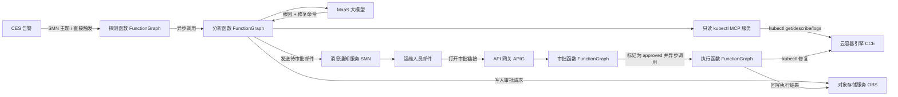

# deterministic-operations-cce-auto-remediation

[](LICENSE)
[](https://support.huaweicloud.com/)
[](#)
> 基于大模型与只读 MCP 的 CCE 集群故障自动检测与「人工审批后自动修复」最佳实践：CES 告警触发检测，MaaS 驱动只读根因探查，修复命令经人工审批后由 kubectl 执行。
---

## 1. 简介 / Overview

### 简介


本仓库 `deterministic-operations-cce-auto-remediation` 是一套可直接落地的云原生运维最佳实践，标题与许可证徽章见本文件顶部。

---

## 2. 目录

- [1. 简介 / Overview](#1-简介--overview)
- [2. 目录](#2-目录)
- [3. 架构图](#3-架构图)
- [4. 方案亮点](#4-方案亮点)
- [5. 涉及云服务](#5-涉及云服务)
- [6. 前置条件](#6-前置条件)
- [7. 快速开始](#7-快速开始)
- [8. 分步部署](#8-分步部署)
- [9. 使用方法 / 验证](#9-使用方法--验证)
- [10. 清理资源](#10-清理资源)
- [11. 详细说明](#11-详细说明)
- [12. 依赖](#12-依赖)
- [13. FAQ / 故障排除](#13-faq--故障排除)
- [14. 贡献指南](#14-贡献指南)
- [15. 许可证](#15-许可证)
- [16. 联系方式 / 维护者](#16-联系方式--维护者)

---

## 3. 架构图

> 告警经 CES 触发，检测函数拉起分析链路，修复命令经人工审批后由执行函数安全落地。



**关键组件说明**

- 云监控服务 CES：集群指标告警源
- 云容器引擎 CCE：被监控与修复的目标集群
- 函数工作流 FunctionGraph：四个函数（探测 / 分析 / 审批 / 执行）
- 大模型服务平台 MaaS：驱动根因分析（默认 deepseek-v4-flash）
- 对象存储服务 OBS：审批请求的持久化存储
- 消息通知服务 SMN：待审批邮件推送
- API 网关 APIG：人工审批端点
- 容器镜像仓库 SWR：函数自定义镜像存储
- 只读 kubectl MCP 服务：在分析函数内以子进程启动，仅暴露只读动词

---

## 4. 方案亮点

- **人类在环**：AI 生成修复建议但绝不自动执行，所有写入操作需人工审批，安全可控
- **只读根因探查**：MCP 服务强制只读动词白名单，大模型无法越权执行写操作
- **安全命令执行**：执行函数内置 kubectl 白名单与危险 shell 字符过滤，YAML 写入临时文件而非管道
- **基础设施即代码**：全部资源以 Terraform 声明，可重复、可审计
- **弹性函数架构**：检测 / 分析 / 审批 / 执行四个函数解耦，按需触发、按需运行

---

## 5. 涉及云服务

| 服务 | 用途 | 备注 |
|---|---|---|
| 云容器引擎 CCE | 目标集群（检测与修复对象） | 集群 + 节点池 |
| 云监控服务 CES | 集群指标告警源 | 触发检测链路 |
| 函数工作流 FunctionGraph | 探测 / 分析 / 审批 / 执行四个函数 | 自定义镜像运行时 |
| 大模型服务平台 MaaS | 根因分析大模型 | 默认 deepseek-v4-flash |
| 对象存储服务 OBS | 审批请求持久化存储 | 生态兼容、按需扩展 |
| 消息通知服务 SMN | 待审批邮件推送 | 邮件订阅 |
| API 网关 APIG | 人工审批端点 | 后端指向审批函数 |
| 容器镜像仓库 SWR | 函数自定义镜像 | 组织 / 仓库两级 |
| 统一身份认证 IAM | 函数委托（agency） | 最小权限 |
| 云日志服务 LTS | 函数与资源日志 | 日志组 / 日志流 |
| 数据加密服务 KMS | 凭据加密 | 可选 |
| 虚拟私有云 VPC / 子网 | 网络平面 | 函数与集群所在网络 |

> **提示**：所有服务均可通过本仓库的 Terraform 一键创建；如需释放，请参见 [第 10 节「清理资源」](#10-清理资源)。

---

## 6. 前置条件

| 项 | 要求 | 说明 |
|---|---|---|
| **账号** | 已开通本云账号并完成实名认证 | 个人 / 企业账号均可 |
| **权限** | 具备 IAM 创建 FunctionGraph / CCE / APIG / SMN / OBS 等资源的能力 | 建议按需最小权限 |
| **Region** | 推荐 `cn-north-4` | 跨区域可能涉及服务可用性差异 |
| **Terraform** | `>= 1.5.0` | IaC 部署工具 |
| **huaweicloud Provider** | `>= 1.97.0` | 本云 Terraform Provider |
| **Docker** | `>= 20.10` | 构建函数自定义镜像 |
| **kubectl** | `>= 1.28` | 集群修复（由执行函数调用） |
| **访问凭据** | 在「我的凭证」页面获取 Access Key 与 Secret Access Key，并配置到环境变量 `HW_ACCESS_KEY` / `HW_SECRET_KEY` | 请勿将凭据写入代码或配置文件 |

---

## 7. 快速开始

### 一键部署（推荐）

```bash
# 1. 进入部署目录
cd deterministic-operations-cce-auto-remediation/infra

# 2. 准备访问凭据
export HW_ACCESS_KEY="<your-access-key>"
export HW_SECRET_KEY="<your-secret-key>"

# 3. 在 terraform.tfvars 中填写区域、委托名、SWR 组织、MaaS 端点等变量

# 4. 初始化并预览
terraform init
terraform plan

# 5. 执行部署
terraform apply -auto-approve
```

> **部署说明**：FunctionGraph 使用自定义镜像，需先将 `docker/*` 四个镜像构建并推送到 SWR，再执行 `terraform apply`（详见 [第 8 节](#8-分步部署)）。

---

## 8. 分步部署

### 步骤 1：构建并推送函数镜像到 SWR

四个函数（detection / analysis / approval / execution）各自对应 `docker/<name>/Dockerfile`。以 detection 为例：

```bash
cd deterministic-operations-cce-auto-remediation
# 登录 SWR（地址见 terraform output 或控制台）
docker build -f docker/detection/Dockerfile -t swr.<region>.myhuaweicloud.com/<swr_org>/mcp-cce-detection:latest .
docker push swr.<region>.myhuaweicloud.com/<swr_org>/mcp-cce-detection:latest
# 同理构建 analysis / approval / execution 三个镜像
```

**预期输出**：四个镜像均推送成功，控制台 SWR 仓库可见对应镜像与版本。

### 步骤 2：初始化 Terraform

```bash
cd deterministic-operations-cce-auto-remediation/infra
terraform init
```

**预期输出**：`Terraform has been successfully initialized!`

### 步骤 3：填写变量并预演

编辑 `terraform.tfvars`，至少填写：`region`、`agency_name`、`swr_org`、`swr_image_detection/analysis/approval/execution`、`maas_*`、`apig_enabled` 等。然后：

```bash
terraform plan
```

**预期输出**：`Plan: N to add, 0 to change, 0 to destroy.`

### 步骤 4：执行部署

```bash
terraform apply -auto-approve
```

**预期输出**：`Apply complete! Resources: N added, 0 changed, 0 destroyed.`

### 步骤 5：记录关键输出

```bash
terraform output
```

**预期输出**：列出四个函数 URN、SMN 主题 URN、APIG 审批 URL、OBS 存储桶名等，请妥善保存并回填到函数环境变量（部分 URN 需重新 `apply` 以串联异步调用链路）。

---

## 9. 使用方法 / 验证

### 验证 1：本地函数加载冒烟测试

```bash
cd deterministic-operations-cce-auto-remediation
HW_REGION=cn-north-4 python -c "
import sys; sys.path.insert(0, 'src')
from functions import detection_function
print('detection_function.handler loaded:', callable(detection_function.handler))
"
```

**预期输出**：打印 `detection_function.handler loaded: True`，表示函数入口与共享模块导入正常。

### 验证 2：端到端告警自愈（需已部署环境）

1. 在 CES 控制台为目标 CCE 集群创建一条测试告警（如 Pod 重启次数），动作指向 SMN 主题或探测函数。
2. 触发告警后，检查 SMN 是否收到待审批邮件，邮件内含 APIG 审批链接。
3. 打开审批链接，提交 `approve` 决定；观察执行函数日志（LTS）是否按 立即 → 预防 → 备选 顺序尝试 kubectl 命令。
4. 在 OBS 审批请求存储中确认状态由 `pending` → `approved` → `completed` / `failed`。

**预期结果**：告警被检测、根因邮件发出、人工审批后修复命令安全执行，状态正确回写。

部署完成后请按本节步骤自行验证，确认业务功能可用，方可视为交付完成。

---

## 10. 清理资源

```bash
# 进入部署目录
cd deterministic-operations-cce-auto-remediation/infra

# 一键释放所有资源
terraform destroy -auto-approve
```

**预期输出**：`Destroy complete! Resources: N destroyed.`

> **避免资源残留**：
> - `terraform destroy` 仅释放 Terraform 状态中追踪的资源；
> - 若通过控制台手动创建了额外资源（如测试告警规则），需手动释放；
> - SWR 镜像如不打算复用可手动删除。

---

## 11. 详细说明

### 方案概述


**中文**：本实践提供一套「大模型 + 只读 MCP」驱动的容器集群故障自愈方案。当云监控服务（CES）产生集群告警时，系统自动检测事件、调用大模型结合只读 kubectl MCP 服务探查根因、生成修复命令，经消息通知服务（SMN）推送待审批邮件，运维人员在 API 网关（APIG）审批端点确认后，执行函数安全地运行 kubectl 修复命令。整个流程「人类在环」，AI 只生成建议、不自动执行写入操作。

**核心能力**

- 告警驱动：CES 告警自动触发检测链路，无需人工巡检
- 只读根因探查：大模型通过自建只读 kubectl MCP 服务收集集群状态，仅允许 list/get/describe
- 人类在环审批：修复命令必须经运维人员通过 APIG 审批端点确认，杜绝误执行
- 安全执行：执行函数内置命令白名单与危险字符过滤，仅放行 kubectl 只读友好的修复动作
- 基础设施即代码：全部资源以 Terraform 声明，函数以自定义镜像部署到 FunctionGraph


### 工作流程

CES 告警 → 探测函数解析告警并异步调用分析函数 → 分析函数拉起只读 kubectl MCP 服务、调用 MaaS 大模型做根因探查 → 生成 `ISSUE EXPLANATION / IMMEDIATE ACTION / PREVENTIVE ACTION / ALTERNATIVE ACTION` 四段分析（每段含 `[KUBECTL]` 命令）→ 在 OBS 写入审批请求并通过 SMN 发送待审批邮件 → 运维人员经 APIG 审批端点确认 → 审批函数标记为 approved 并异步调用执行函数 → 执行函数配置 CCE kubeconfig、按序执行 kubectl 命令、回写结果。

### 安全模型

- **只读 MCP**：MCP 服务仅暴露 `get / describe / logs / top` 等只读动词，大模型探查阶段无法执行写操作。
- **命令白名单**：执行函数仅放行 `kubectl`，拒绝 `&& || ; | \` $( > <` 等危险字符，YAML 清单写入临时文件而非管道。
- **人类在环**：任何修复命令必须经 APIG 审批端点的人工 `approve` 决定才会执行。
- **最小权限委托**：四个 FunctionGraph 函数绑定具备必要权限的 IAM 委托（agency），不将访问凭据明文写入环境变量。

### 配置项（关键环境变量）

| 变量 | 说明 |
|---|---|
| `HW_REGION` | 区域 |
| `ANALYSIS_FUNCTION_URN` | 分析函数 URN（探测函数异步调用目标） |
| `EXECUTION_FUNCTION_URN` | 执行函数 URN（审批函数异步调用目标） |
| `OBS_BUCKET` / `OBS_KEY_PREFIX` | 审批请求持久化存储桶与键前缀 |
| `APPROVAL_TOPIC_URN` | SMN 审批主题 URN |
| `APIG_APPROVAL_URL` | APIG 审批端点地址 |
| `MAAS_BASE_URL` / `MAAS_API_KEY` / `MAAS_MODEL_ID` | MaaS 端点与模型 |
| `CLUSTER_ID` | 目标 CCE 集群 ID（执行函数） |

---

## 12. 依赖

### 主要依赖

| 名称 | 版本 | 用途 |
|---|---|---|
| Terraform | `>= 1.5.0` | IaC 编排 |
| huaweicloud Provider | `>= 1.97.0` | 本云资源 |
| Docker | `>= 20.10` | 函数镜像构建 |
| kubectl | `>= 1.28` | 集群修复 |
| Python | `>= 3.10` | 函数运行时 |
| openai | `>= 1.30` | MaaS OpenAI 兼容客户端 |
| huaweicloudsdk* | `>= 3.1.0` | CCE / SMN / FunctionGraph / KMS SDK |
| esdk-obs-python | `>= 3.23.0` | 审批请求持久化（OBS） |

---

## 13. FAQ / 故障排除

### Q1：SMN 未收到待审批邮件？

**A**：确认 `APPROVAL_TOPIC_URN` 正确，且主题已订阅运维邮箱；检查分析函数日志是否成功创建 OBS 审批请求（依赖 `OBS_BUCKET` 与 IAM 委托的 OBS 权限）。

### Q2：审批后执行函数未运行？

**A**：确认 `EXECUTION_FUNCTION_URN` 已填入审批函数环境变量，且审批函数异步调用返回成功；检查执行函数日志是否成功获取 CCE kubeconfig（依赖 `CLUSTER_ID` 与 IAM 委托权限）。

### Q3：执行函数拒绝 kubectl 命令？

**A**：执行函数仅放行 `kubectl` 且禁止危险字符。确认 MaaS 生成的命令以 `[KUBECTL]` 开头、不含管道 / 重定向 / 命令连接符。

### 故障排查清单

| 现象 | 可能原因 | 排查方法 |
|---|---|---|
| 分析函数超时 | MaaS 端点不可达或模型名错误 | 检查 `MAAS_BASE_URL` / `MAAS_MODEL_ID` |
| 只读探查无输出 | MCP 服务未启动或 kubeconfig 缺失 | 检查分析函数日志中 MCP 子进程启动信息 |
| 审批链接 404 | APIG 未启用或未部署 | 确认 `apig_enabled=true` 且 `terraform apply` 包含 APIG 资源 |

---

## 14. 贡献指南

欢迎提交 Issue 与 PR。请遵循以下流程：

1. **Issue**：描述问题 / 建议（含复现命令、预期 / 实际输出）
2. **PR**：基于 `main` 分支新建 feature 分支；提交前运行 `terraform validate` 与 `terraform fmt -check`
3. **Code Review**：由 reviewer 审核通过后合并

详细规范参见 `CONTRIBUTING.md`（如有）。

---

## 15. 许可证

本实践采用 **MIT No Attribution** 许可证发布。详见仓库根目录 [LICENSE](LICENSE) 文件。

```
MIT No Attribution

Copyright (c) Huawei Cloud

Permission is hereby granted, free of charge, to any person obtaining a copy
of this software... (no attribution required)
```

---

## 16. 联系方式 / 维护者
| 项 | 内容 |
|---|---|
| **创建者** | [dgc-git](https://github.com/dgc-git) |
| **维护者** | [dgc-git](https://github.com/dgc-git) |
| **联系方式** | GitHub Issues / PR（见[第 14 节](#14-贡献指南)） |
