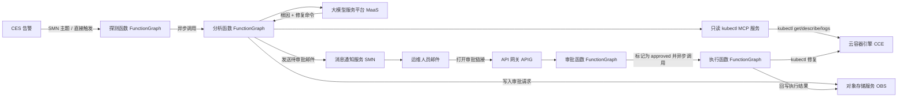

# 架构说明

本实践是一套基于大模型与只读 MCP 的 CCE 集群故障自动检测与「人工审批后自动修复」方案。告警由云监控服务（CES）产生，经检测链路驱动大模型根因探查，修复命令经人工审批后由 kubectl 安全执行。

## 整体架构

## 组件职责

### 云监控服务 CES

集群指标告警源。告警动作指向 SMN 主题或直接指向探测函数，作为整个自愈链路的起点。

### 云容器引擎 CCE

被监控与修复的目标集群。执行函数通过 CCE SDK 获取的 kubeconfig 对其执行 kubectl 修复命令。

### 函数工作流 FunctionGraph（四个函数）

| 函数 | 职责 |
|---|---|
| 探测函数 | 解析 CES 告警、采集集群信息、组装事件体，异步调用分析函数 |
| 分析函数 | 拉起只读 MCP 服务、调用 MaaS 做根因探查，在 OBS 写审批请求并发送 SMN 邮件 |
| 审批函数 | 由 APIG 触发，读取审批请求、标记 approved，并异步调用执行函数 |
| 执行函数 | 配置 CCE kubeconfig，按 立即 → 预防 → 备选 顺序执行 kubectl 命令，回写结果 |

四个函数均以自定义镜像部署，运行时由 `runtime_shim.py` 提供 HTTP 健康检查（`/healthz`）与事件入口（`/invoke`），业务代码保持平台无关的 `handler(event, context)` 签名。

### 大模型服务平台 MaaS

驱动根因分析。通过 OpenAI 兼容接口暴露，支持 tool calling；默认模型 deepseek-v4-flash。模型抽象层（`model_adapter.py`）将对话循环与工具调用封装为统一接口，业务代码无需关心底层模型细节。

### 只读 kubectl MCP 服务

在分析函数内以子进程方式启动的 stdio JSON-RPC 服务，暴露一组只读 kubectl 工具（list_pods / get_pod / list_deployments / get_deployment / list_nodes / get_node / list_events / get_logs / list_services / describe_resource）。服务强制只读动词白名单，绝不执行 create / apply / edit / delete 等写操作。

### 对象存储服务 OBS

审批请求的状态存储。记录每条审批请求的 `pending / approved / rejected / completed / failed` 状态、修复命令与执行结果。

### 消息通知服务 SMN

分析函数通过 SMN 主题向运维人员推送待审批邮件，邮件内含 APIG 审批链接。

### API 网关 APIG

提供人工审批端点，后端指向审批函数。运维人员打开邮件中的审批链接并做出 `approve` / `reject` 决定。

### 容器镜像仓库 SWR

存储四个函数的自定义镜像（detection / analysis / approval / execution）。

## 数据模型（OBS 审批请求）

| 字段 | 说明 |
|---|---|
| `request_id` | 审批请求唯一 ID（UUID） |
| `incident_id` | 关联事件 ID |
| `cluster_name` | 目标集群 ID |
| `alarm_name` | 告警名称 |
| `status` | pending / approved / rejected / completed / failed |
| `risk_level` | 风险等级 high / medium / low |
| `immediate_action_command` | 立即动作命令 |
| `preventive_action_command` | 预防动作命令 |
| `alternative_action_command` | 备选动作命令 |
| `created_at` / `ttl` | 创建时间 / 24 小时过期 |

## 安全设计

- **只读探查**：MCP 服务仅暴露只读动词，大模型探查阶段无法越权写操作。
- **命令白名单**：执行函数仅放行 `kubectl`，拒绝 `&& || ; | \` $( > <` 等危险字符；YAML 清单写入临时文件而非管道。
- **人类在环**：任何修复命令必须经 APIG 审批端点的人工 `approve` 决定才会执行。
- **最小权限委托**：函数绑定具备必要权限的 IAM 委托（agency），访问凭据不写入环境变量明文。

## 弹性与可观测

- 四个函数解耦、按需触发，无需常驻计算。
- 函数日志统一采集到云日志服务（LTS），便于排障与审计。
- 凭据（如需要）经数据加密服务（KMS）管理。
